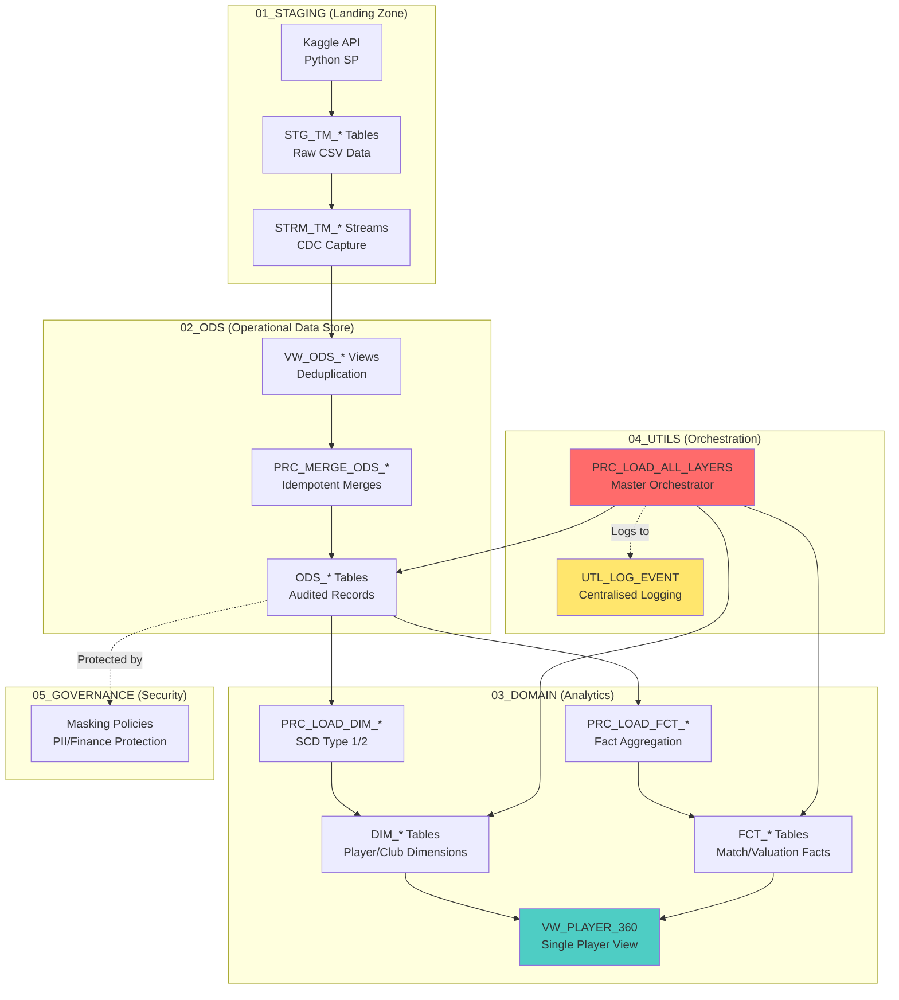

# London Lions Player Analytics Platform (SPV)

[](https://www.snowflake.com/)
[](https://docs.snowflake.com/)
[](https://github.com/ElliottFairhall/london-lions-analytics)


A production-grade Snowflake Cloud Data Platform for the **London Lions Football Club**. The platform implements a
modern "Single Player View" (SPV) using a Medallion architecture, Kimball dimensional modelling, SCD Type 2 history
tracking, and a comprehensive data governance framework.

______________________________________________________________________

## Features

- **Medallion Architecture** - Three-layer design: Staging (Kaggle ingestion), ODS (deduplicated operational store), and
  Domain (analytical star schema).
- **Dimensional Model** - Historical SCD Type 2 dimension for players and SCD Type 1 for clubs, supporting point-in-time
  performance analysis.
- **Instrumented ETL** - Master orchestration procedure with centralized event logging, row-counting, and error
  handling.
- **Player 360** - Consolidated analytical view tracking match statistics, disciplinary records, and market value trend
  deltas.
- **UK-Specific Standards** - Adherence to British English, footballing terminology, and professional sports
  administration standards.

______________________________________________________________________

## Architecture



### Layer Overview

| Layer             | Purpose                         | Key Objects                                    |
| ----------------- | ------------------------------- | ---------------------------------------------- |
| **01_STAGING**    | Raw data landing (Kaggle API)   | Python Ingestion SP, 5+ STG tables, streams    |
| **02_ODS**        | Deduplicated operational store  | ODS tables, deduplication views, merge procs   |
| **03_DOMAIN**     | Dimensional model for analytics | DIM_PLAYER (SCD2), DIM_CLUB, Facts, Player 360 |
| **04_UTILS**      | Utilities and orchestration     | Centralized logging, master load procedure     |
| **05_GOVERNANCE** | Security and compliance         | Masking policies for PII and financial data    |

______________________________________________________________________

## Dimensional Model

### Dimensions

| Table      | SCD Type | Tracked Changes                        |
| ---------- | -------- | -------------------------------------- |
| DIM_PLAYER | Type 2   | Market value changes, club migrations  |
| DIM_CLUB   | Type 1   | Stadium name, current valuation status |

### Fact Tables

| Table           | Grain      | Key Measures                                |
| --------------- | ---------- | ------------------------------------------- |
| FCT_PERFORMANCE | Per Match  | Minutes, Goals, Assists, Cards, G/A per 90  |
| FCT_VALUATIONS  | Per Update | Market Value (EUR), Valuation Delta (Trend) |

______________________________________________________________________

## ETL Pipeline

The master orchestration procedure `PRC_LOAD_ALL_LAYERS` runs a sequential 3-phase pipeline:

1. **Phase 1 - ODS Layer**: Deduplicate and load from Staging via CDC streams using robust MD5 hashing.
2. **Phase 2 - Dimensions**: Apply SCD Type 2 logic to Player profiles and SCD Type 1 to Clubs.
3. **Phase 3 - Facts**: Load performance and valuation facts with point-in-time dimension alignment.

**Centralised Logging**: All procedures call `UTL_LOG_EVENT` to record execution status and row counts to the
`INGESTION_LOG` table.

______________________________________________________________________

## Technical Setup: Kaggle API Ingestion

To use the automated ingestion procedure, you must provide your own Kaggle API credentials.

### 1. Obtain Kaggle API Credentials

1. Log in to your [Kaggle Account](https://www.kaggle.com/).
2. Go to your **Settings** (Account profile).
3. Scroll down to the **API** section and click **Create New Token**.
4. A `kaggle.json` file will download containing your `username` and `key`.

### 2. Configure Snowflake Secrets

Once you have deployed the environment, you must populate the Snowflake Secret with your credentials:

```sql
ALTER SECRET LIONS_DB.STAGING.KAGGLE_API_CREDENTIALS
SET SECRET_STRING = '{"username":"YOUR_KAGGLE_USER","key":"YOUR_KAGGLE_KEY"}';
```

______________________________________________________________________

## Project Structure

```text
london-lions-analytics/
├── README.md
├── Brief/                          # Business context and club requirements
├── Schema/
│   └── Schema.dbml                 # Entity-relationship schema
├── Snowflake/
│   ├── 00_INIT/                    # Database and environment setup
│   ├── 01_STAGING/                 # Python ingestion and streams
│   ├── 02_ODS/                     # Deduplication and merge procedures
│   ├── 03_DOMAIN/                  # Dimensional model and analytical views
│   ├── 04_UTILS/                   # Logging and orchestration
│   └── 05_GOVERNANCE/              # Security and masking policies
└── Test_Data/                      # Local metadata and dataset references
```

______________________________________________________________________

## Deployment Sequence

```sql
-- 1. Initialise environment
@Snowflake/00_INIT/01_CREATE_ENV.sql

-- 2. Deploy utilities
@Snowflake/04_UTILS/01_SETUP_LOGGING.sql
@Snowflake/04_UTILS/02_UTL_LOG_EVENT.sql
@Snowflake/04_UTILS/Procedures/PRC_LOAD_ALL_LAYERS.sql

-- 3. Staging & Ingestion
@Snowflake/01_STAGING/Procedures/PRC_INGEST_KAGGLE_DATA.sql

-- 4. ODS layer
@Snowflake/02_ODS/Tables/*.sql
@Snowflake/02_ODS/Views/*.sql
@Snowflake/02_ODS/Procedures/*.sql

-- 5. Domain layer
@Snowflake/03_DOMAIN/Tables/*.sql
@Snowflake/03_DOMAIN/Procedures/*.sql
@Snowflake/03_DOMAIN/Views/*.sql

-- 6. Run full pipeline
CALL LIONS_DB.UTILS.PRC_LOAD_ALL_LAYERS();
```

______________________________________________________________________

## Author

**London Lions Analytics Department**

*Standardised for professional sport administration standards.*
